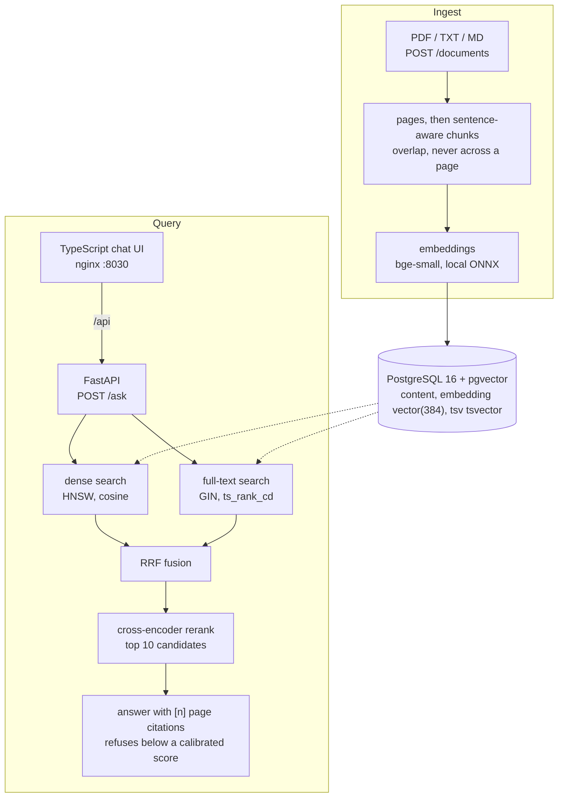

# synthlayer-rag-core

[](https://github.com/Darlinglove002/synthlayer-rag-core/actions/workflows/ci.yml)



A small, readable RAG core that keeps **everything in one PostgreSQL**: vectors (`pgvector`) and the full-text index (`tsvector`) sit in the same table, are queried together, fused, reranked, and turned into an answer that **cites the exact page**. It ships with an eval harness, a FastAPI service, and a dependency-free TypeScript chat UI, and the whole stack starts with one command.

```bash
docker compose up --build        # then open http://localhost:8030
```

No API key needed: embeddings and the reranker are local ONNX models. Set `ANTHROPIC_API_KEY` to get LLM-written answers instead of extractive ones.

## Example Request & Response

Index one of the bundled PDFs, then ask a question it answers and one it does not. The output is real, from this code with no `ANTHROPIC_API_KEY` set (so the answer is extractive); scores are rounded and long texts are shortened with `…`.

```bash
curl -s -X POST http://localhost:8020/documents -F "file=@eval/corpus/brightbay_admin_guide.pdf"
```

```json
{"document_id": 1, "title": "brightbay_admin_guide", "pages": 5, "chunks": 6, "skipped": false}
```

```bash
curl -s -X POST http://localhost:8020/ask \
  -H "Content-Type: application/json" \
  -d '{"query": "How long are old snapshots kept before being deleted?", "top_k": 2}'
```

```json
{
  "answer": "By default old snapshots are deleted after 14 days; change this with the configuration key backup.retention_days. [1]",
  "grounded": true,
  "generator": "extractive",
  "citations": [
    {"n": 1, "document_id": 1, "title": "brightbay_admin_guide", "page": 2,
     "snippet": "Backups. Brightbay takes a full snapshot every night at 02:30 UTC. … By default old snapshots are deleted after 14 days; …"}
  ],
  "sources": [
    {"title": "brightbay_admin_guide", "page": 2, "score": 6.68, "content": "Backups. Brightbay takes a full snapshot every night at 02:30 UTC. …"},
    {"title": "brightbay_admin_guide", "page": 5, "score": -6.88, "content": "Upgrades. Brightbay supports rolling upgrades with no downtime, …"}
  ]
}
```

`score` is the cross-encoder logit; the refusal threshold (`-3.0`) is applied to the best one. A question the documents do not answer gets a refusal with no citations (`sources` still lists what was retrieved):

```bash
curl -s -X POST http://localhost:8020/ask \
  -H "Content-Type: application/json" \
  -d '{"query": "What is the capital of France?", "top_k": 2}'
```

```json
{"answer": "I couldn't find this in the indexed documents.", "grounded": false, "generator": "none", "citations": [], "sources": ["…"]}
```

`GET /health` runs a real `SELECT 1` on a fresh connection. Healthy:

```json
{"status": "ok", "checks": {"postgres": "ok"}, "modes": ["dense", "lexical", "hybrid", "hybrid_rerank"], "llm": false}
```

With the database container frozen (`docker pause`), the same call returns HTTP 503 after about 4 s and recovers as soon as the container is unfrozen:

```json
{"status": "unavailable", "checks": {"postgres": "down"}, "failed": ["postgres"]}
```

## Why two channels

Dense search finds paraphrases ("how much memory?" → "16 GB of RAM") but is unreliable on identifiers (`E-4012`, `db.pool_max`). Full-text search is exact on identifiers and weak on paraphrase. Reciprocal Rank Fusion combines the two rankings without having to normalise their incompatible scores; a cross-encoder then rereads the top candidates together with the question.

The lexical query is rewritten from `AND` to `OR` (`plainto_tsquery(...)` with `&` → `|`), because an AND over a natural-language question matches almost nothing; `ts_rank_cd` still prefers chunks that contain many terms close together.

## Measured results

`python -m eval.run_eval` builds a throwaway database, indexes three PDFs, and runs 35 scored questions (15 paraphrased, 15 identifier-style, 5 mixed) plus 5 out-of-scope ones. Gold = exact document + page. Full report: [eval/RESULTS.md](eval/RESULTS.md).

| mode | hit@1 | hit@3 | MRR | p50 latency |
|---|---|---|---|---|
| dense only | 91.4% | 94.3% | 0.929 | 165 ms |
| lexical only | 82.9% | 94.3% | 0.877 | 71 ms |
| hybrid (RRF) | 88.6% | 100% | 0.938 | 175 ms |
| hybrid + rerank | 100% | 100% | 1.000 | 1272 ms |

By slice, the channels are strong in different places: lexical gets 100% hit@1 on identifier questions but only 60% on paraphrases, while dense gets 93.3% on paraphrases and 86.7% on identifiers. Fusion lifts hit@3 to 100% but not hit@1 (88.6%, slightly below dense alone on this corpus); the rerank step is what fixes the ordering.

**Read these honestly.**
- The corpus is tiny (16 chunks) and synthetic, written by me together with the questions. It makes a good regression baseline and a clear demonstration of the two channels; it is **not** a benchmark. With 16 chunks the reranker sees almost the whole corpus, so a 100% here says little about large collections.
- Rerank latency is CPU-only (~45 ms per candidate passage, 10 candidates). A GPU or a smaller `RERANK_POOL` changes this; quality at larger pools was not tested on a corpus big enough to matter.
- **Refusal is only partly solved.** A single threshold on the cross-encoder score cannot cleanly separate "not in the documents" from "paraphrased question": at the configured `-3.0`, 88.6% of in-scope questions are answered and 80% of out-of-scope ones refused (end to end: 31/35 answered, 4/5 refused). Five off-topic questions are too few to calibrate anything properly. With an LLM key the model is also instructed to refuse when the sources do not contain the answer, which is the second line of defence.
- The extractive generator quotes one sentence. In the run above it cited the gold page in 30 of the 31 questions it answered.

## API

| endpoint | purpose |
|---|---|
| `POST /documents` (multipart `file`) | index a PDF / TXT / MD (max 20 MB); identical re-upload is skipped, changed content replaces the old version atomically |
| `GET /documents`, `DELETE /documents/{id}` | list / remove |
| `POST /search` `{query, mode, top_k}` | raw hits; `mode` = `dense` \| `lexical` \| `hybrid` \| `hybrid_rerank`, each hit shows its dense/lexical rank and rerank score |
| `POST /ask` `{query, top_k}` | answer with `[n]` markers, `citations[{title,page,snippet}]`, `grounded`, and the sources used |
| `GET /health` | readiness, always open: real `SELECT 1`; `200`, or `503` with `failed: ["postgres"]` |

Interactive docs at `http://localhost:8020/docs`.

Logs are one line per event on stderr (time, level, logger, message); `LOG_LEVEL` sets the level (default `INFO`). Uploaded file names are logged, question text never is. Every setting is listed in [`.env.example`](.env.example).

## TypeScript client and UI (`web/`)

Zero runtime dependencies; `typescript` and `@types/node` are the only dev dependencies. [`web/src/client.ts`](web/src/client.ts) is a typed `fetch` wrapper that works in browsers and Node 20+:

```ts
import { RagClient } from "./client.js";
const rag = new RagClient({ baseUrl: "http://localhost:8020" });   // apiKey: "..." if the server sets API_KEY
const a = await rag.ask("How long are snapshots kept?");
console.log(a.answer, a.citations[0].page);
```

The chat UI (`main.ts` + one HTML and one CSS file) is served by nginx, which also proxies `/api/` to the Python service, so the browser talks to a single origin. All document text is rendered through `textContent`, never `innerHTML`, and nginx sends a strict CSP.

## Development

```bash
docker compose up -d db                       # PostgreSQL + pgvector on :5444
py -3.12 -m venv .venv && .venv/Scripts/pip install -e ".[dev]"   # or python3 -m venv on Linux/macOS
pytest                                        # unit + integration (real DB, real models)
ruff check . && ruff format --check . && mypy   # lint, formatting, types (same as CI)
python -m eval.run_eval                       # retrieval report; fails if hybrid_rerank hit@3 < 0.9
uvicorn app.api:app --port 8020 --reload
cd web && npm ci && npm test                  # TypeScript: tsc + node:test
python scripts/smoke.py http://localhost:8030 # smoke test of the running stack
```

CI ([.github/workflows/ci.yml](.github/workflows/ci.yml)) runs three jobs: Python (ruff, mypy, pytest, eval with a regression floor), web (tsc + tests), and **stack** (`docker compose up --wait`, then the smoke test through the nginx proxy).

## Security notes

- Ports are published on `127.0.0.1` only. The API has no accounts; set `API_KEY` to require an `X-API-Key` header (compared in constant time). It is a shared secret, not user auth: put a real auth layer in front before exposing it.
- Uploads: extension allow-list (`pdf`, `txt`, `md`), 20 MB cap, filename reduced to its basename and never used as a path, PDF parse errors become 422 rather than 500. Scanned PDFs without a text layer are rejected (no OCR).
- All SQL is parameterised; there is a test that feeds an injection string through search.
- The API container runs as a non-root user. Documents are sent to Anthropic only if you set `ANTHROPIC_API_KEY`; otherwise nothing leaves your machine.

## Known limits

Single-tenant (no per-user document isolation), English text search configuration (`to_tsvector('english', …)`; other languages need another config and embedding model), `vector(384)` is fixed in the schema to match the default model, no OCR, no streaming answers, and no incremental re-indexing inside a document (a changed file is replaced whole).
